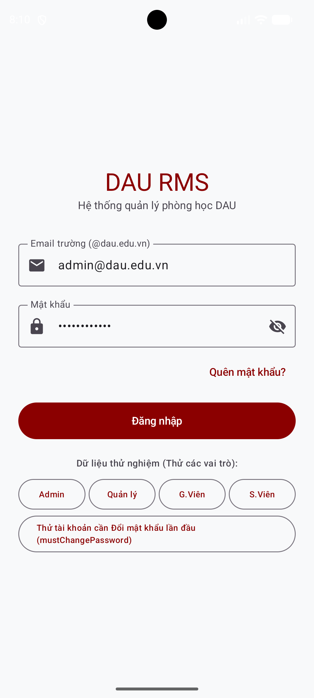
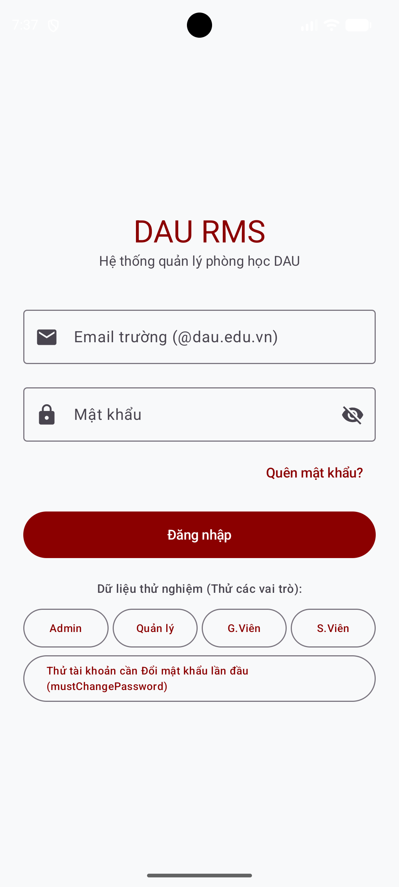
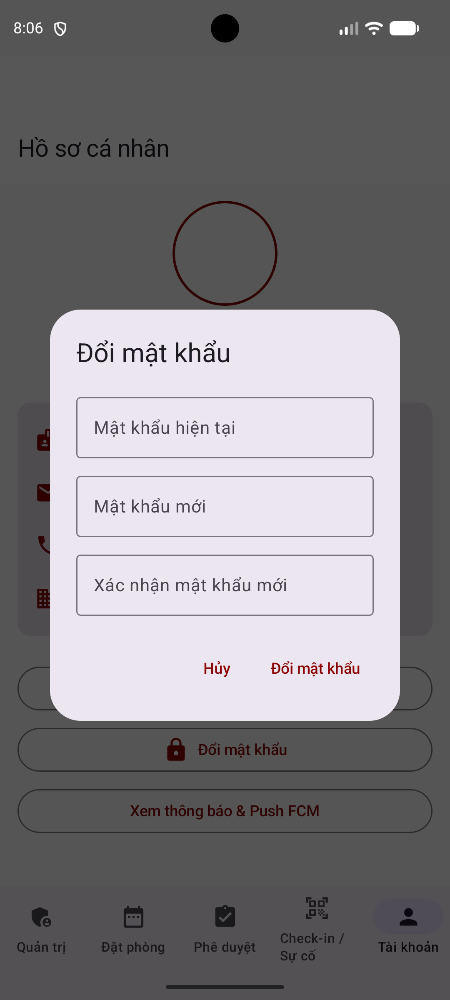
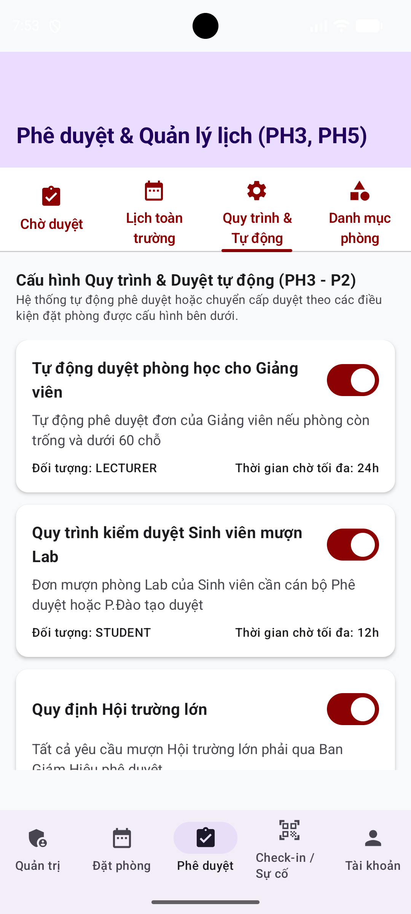
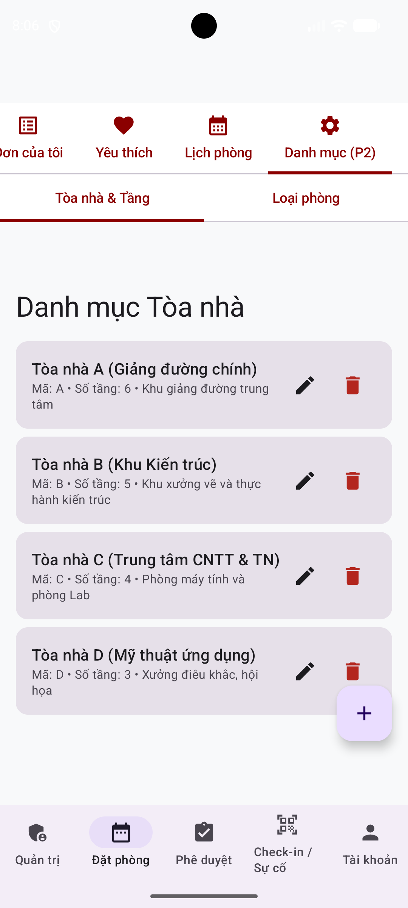
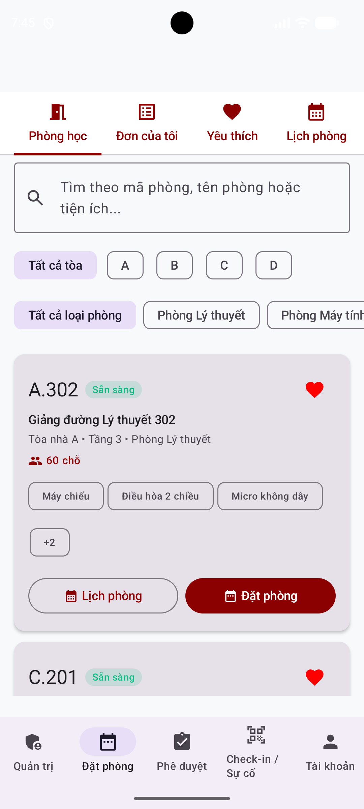
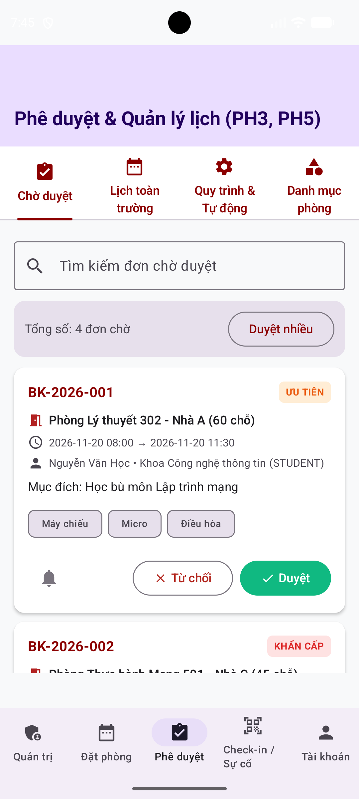
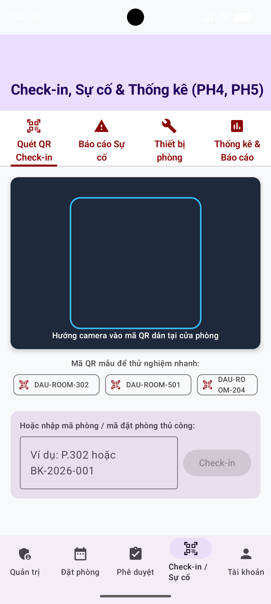
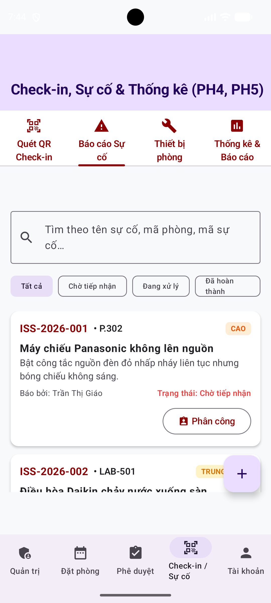
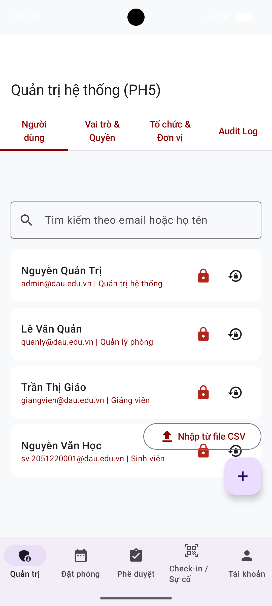

<div align="center">

# 🏫 DAU RMS

### Ứng dụng quản lý và đặt phòng học
**Trường Đại học Kiến trúc Đà Nẵng**

Đặt phòng nhanh · Duyệt theo quy trình · Check-in bằng QR · Báo sự cố tức thì


<!-- Thay bằng ảnh thật: chụp 3-4 màn hình ghép lại thành một ảnh banner -->


</div>

---

## 📖 Giới thiệu

Trước đây, việc xin phòng học, chờ duyệt và kiểm tra ai đang dùng phòng phải làm thủ công, dễ **trùng lịch** và khó theo dõi. **DAU RMS** đưa toàn bộ quy trình đó lên điện thoại:

- Sinh viên, giảng viên **xem phòng trống và đặt phòng** chỉ vài chạm.
- Quản lý phòng **duyệt hoặc từ chối** đơn, hệ thống tự chặn đặt trùng.
- Người dùng **check-in bằng mã QR** khi đến phòng, trả phòng đúng giờ.
- Gặp hỏng hóc thì **báo sự cố** ngay trong ứng dụng.
- Quản trị viên **cấp tài khoản và phân quyền** cho từng vai trò.

Giao diện **hoàn toàn bằng tiếng Việt**, thiết kế theo Material 3.

---

## 📱 Giao diện ứng dụng


| Đăng nhập | Đổi mật khẩu | Quy Trình Tự Phê Duyệt Tự Động |
|:---:|:---:|:---:|
|  |  |  |

| Danh mục phòng | Đặt phòng | Duyệt đơn |
|:---:|:---:|:---:|
|  |  |  |

| Check-in QR | Báo sự cố | Quản trị người dùng |
|:---:|:---:|:---:|
|  |  |  |

---

## ✨ Tính năng chính

### 👤 Tài khoản
- Đăng nhập bằng tài khoản **do Quản trị viên cấp** (không tự đăng ký).
- **Bắt buộc đổi mật khẩu** ở lần đăng nhập đầu tiên.
- Xem và sửa hồ sơ cá nhân, đổi mật khẩu.
- Nhận thông báo ngay trong ứng dụng và thông báo đẩy.

### 📅 Đặt phòng
- Tra cứu phòng theo tòa nhà, loại phòng, thiết bị.
- Đặt phòng theo ngày giờ; hệ thống **kiểm tra và chặn trùng lịch**.
- Chia sẻ lượt đặt phòng với người khác, theo dõi trạng thái đơn.

### ✅ Phê duyệt
- Quản lý phòng xem đơn chờ duyệt, **duyệt hoặc từ chối** kèm lý do.
- Người đặt nhận thông báo kết quả ngay.

### 📷 Check-in và sự cố
- **Check-in bằng QR** trong khung giờ: từ 15 phút trước đến 30 phút sau giờ bắt đầu.
- Trả phòng với thời gian ân hạn 15 phút.
- Báo sự cố theo 4 mức: **Thấp, Trung bình, Cao, Nghiêm trọng**.

### 🛠️ Quản trị
- Tạo, khóa, mở khóa tài khoản; **cấp mật khẩu tạm** cho người dùng mới.
- Quản lý **9 vai trò** và **12 quyền**, quản lý đơn vị (khoa, phòng ban).
- **Nhật ký hoạt động** để truy vết thao tác.

---

## 👥 Ai dùng được gì?

Ứng dụng có **9 vai trò**. Thanh điều hướng và các nút trên màn hình thay đổi theo quyền của từng người, nên mỗi người chỉ thấy đúng chức năng của mình.

| Vai trò | Dùng để |
|---|---|
| Sinh viên | Xem phòng, đặt phòng, check-in, báo sự cố |
| Giảng viên | Như sinh viên, ưu tiên đặt phòng cho lớp học |
| Quản lý phòng | Duyệt đơn, theo dõi phòng và sự cố |
| Quản trị viên | Cấp tài khoản, phân quyền, xem nhật ký |

Các vai trò khác do Quản trị viên cấu hình trong ứng dụng.

---

## 🔐 Cách có tài khoản

DAU RMS **không có đăng ký công khai**. Để dùng ứng dụng:

1. Liên hệ **Quản trị viên** để được cấp tài khoản.
2. Nhận **email đăng nhập và mật khẩu tạm**.
3. Đăng nhập lần đầu, ứng dụng yêu cầu **đặt mật khẩu mới**.
4. Sau đó dùng ứng dụng bình thường.

---

## 🧪 Dùng thử nhanh (dữ liệu mẫu)

Bản dữ liệu mẫu (flavor `mock`) chạy không cần máy chủ, dùng để xem giao diện:

| Vai trò | Tài khoản | Mật khẩu |
|---|---|---|
| Quản trị viên | `admin` | `Password123@` |
| Quản lý phòng | `quanly` | `Password123@` |
| Giảng viên | `giangvien` | `Password123@` |
| Sinh viên | `2051220001` | `Password123@` |

> Đây chỉ là tài khoản của dữ liệu giả. Bản chạy thật dùng tài khoản do Quản trị viên cấp.

---

## 🚀 Cài đặt và chạy

### Yêu cầu
- Android Studio Ladybug (2024.2.1) trở lên, **JDK 17**
- Android 8.0 trở lên (Min SDK 26, Compile SDK 35)

### Chạy ứng dụng
```bash
git clone https://github.com/ThanhShine/LapTrinhMang.git
cd LapTrinhMang
```
Mở thư mục bằng Android Studio, bấm **Sync Now**, rồi chọn biến thể build:

| Biến thể | Dùng khi | Dữ liệu |
|---|---|---|
| `mockDebug` | Xem giao diện, không có máy chủ | Dữ liệu giả |
| `devDebug` | Chạy với backend thật | MySQL qua API |

Dòng lệnh: `gradlew assembleDebug` để dựng APK, `gradlew test` để chạy kiểm thử.

### Chạy cùng backend thật (biến thể `devDebug`)
1. Cài **MySQL 8**, nhập file `dau_rms.sql` để tạo CSDL.
2. Vào thư mục `backend/`, sao chép `.env.example` thành `.env` rồi điền thông tin của bạn (**không đưa `.env` lên GitHub**).
3. Chạy `npm install`, rồi `npm run create-admin` để tạo tài khoản Quản trị viên đầu tiên.
4. Chạy `npm start`, máy chủ lắng nghe ở cổng `3000`.
5. Trên máy ảo Android, ứng dụng gọi máy chủ qua `http://10.0.2.2:3000/api/v1/`.

---

## 🧱 Công nghệ

| Phần | Công nghệ |
|---|---|
| Ứng dụng Android | Kotlin, Jetpack Compose, Material 3, MVVM, Hilt, Navigation Compose |
| Mạng và lưu trữ | Retrofit, OkHttp, DataStore (token mã hóa) |
| Quét mã QR | CameraX, ML Kit |
| Thông báo | Firebase Cloud Messaging |
| Backend | Node.js 20, Express, JWT, bcrypt |
| Cơ sở dữ liệu | MySQL 8 (27 bảng) |

```text
LapTrinhMang/
├── app/                  # Ứng dụng chính, điều hướng
├── core/
│   ├── model/            # Mô hình dữ liệu, vai trò, quyền
│   ├── network/          # Retrofit, JWT, token mã hóa, dữ liệu giả
│   └── ui/               # Giao diện chung, phân quyền trên màn hình
├── feature/
│   ├── account/          # Tài khoản, hồ sơ, thông báo
│   ├── booking/          # Đặt phòng
│   ├── approval/         # Phê duyệt
│   ├── checkin/          # Check-in, sự cố
│   └── admin/            # Quản trị người dùng, vai trò, đơn vị
├── backend/              # Máy chủ Node.js (nếu có trong kho này)
└── docs/                 # Tài liệu API và báo cáo
```

---

## 👨‍💻 Nhóm thực hiện

| Thành viên | Phụ trách |
|---|---|
| Thành | Nền tảng chung, tài khoản, quản trị, tích hợp |
| Trinh | Đặt phòng |
| Phong | Phê duyệt |
| Bảo | Check-in và sự cố |

---

## 📚 Tài liệu cho nhóm phát triển

- Hợp đồng API: [`docs/api-account.md`](docs/api-account.md), [`api-booking.md`](docs/api-booking.md), [`api-approval.md`](docs/api-approval.md), [`api-checkin.md`](docs/api-checkin.md)
- Quy tắc làm việc nhóm, đặt tên nhánh, quy trình Pull Request: xem [`HUONG_DAN.md`](HUONG_DAN.md)

---

<div align="center">

Đồ án thực hiện tại **Trường Đại học Kiến trúc Đà Nẵng** · 2026

</div>